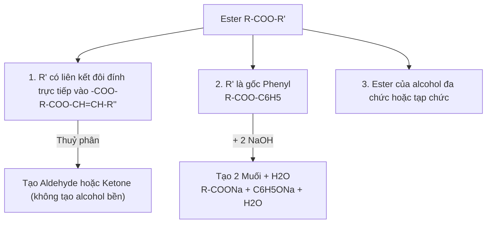

# 📌 Chủ Đề: Ester - Cấu Tạo, Tính Chất & Điều Chế

> **Chương trình:** Hóa Học 12 (GDPT 2018)  
> **Chương I:** Ester - Lipid - Xà phòng và chất giặt rửa  
> **Mức độ:** Nhận biết - Thông hiểu - Vận dụng

---

## 🎯 Mục Tiêu Bài Học
- Nêu được khái niệm, công thức chung, đặc điểm cấu tạo phân tử của ester.
- Viết được công thức cấu tạo và gọi tên các ester theo danh pháp IUPAC và tên thông thường.
- Giải thích được tính chất vật lí (nhiệt độ sôi, tính tan, mùi hương đặc trưng).
- Trình bày được tính chất hoá học đặc trưng: Phản ứng thuỷ phân trong môi trường acid (thuận nghịch) và môi trường kiềm (xà phòng hoá một chiều).
- Thực hiện phương pháp điều chế ester bằng phản ứng ester hoá Fischer.

---

## 📖 I. Lý Thuyết Trọng Tâm

### 1. Khái niệm và Cấu Tạo Phân Tử
Khi thay thế nhóm $-\text{OH}$ ở nhóm carboxyl của carboxylic acid bằng nhóm $-\text{OR}'$ thì thu được ester.

Công thức tổng quát của ester đơn chức:
$$R-\text{COO}-R'$$
*(Trong đó $R$ là gốc hydrocarbon hoặc nguyên tử $H$; $R'$ là gốc hydrocarbon, $R' \ne H$)*.

Ester no, đơn chức, mạch hở có công thức phân tử chung là:
$$\text{C}_n\text{H}_{2n}\text{O}_2 \quad (n \ge 2)$$

### 2. Danh Pháp (Tên Gọi)
$$\text{Tên ester} = \text{Tên gốc hydrocarbon } R' + \text{Tên gốc acid } R\text{COO} (\text{đuôi } \textbf{-ate})$$

**Ví dụ:**
- $\text{HCOOCH}_3$: Methyl formate
- $\text{CH}_3\text{COOC}_2\text{H}_5$: Ethyl acetate
- $\text{CH}_2=\text{CH-COOCH}_3$: Methyl acrylate
- $\text{CH}_3\text{COOCH}_2\text{C}_6\text{H}_5$: Benzyl acetate (mùi hoa nhài)
- $\text{CH}_3\text{COOCH}_2\text{CH}_2\text{CH(CH}_3)_2$: Isoamyl acetate (mùi chuối chín)

---

## 🔢 II. Hệ Thống Tính Chất Hoá Học

### 1. Phản ứng thuỷ phân trong môi trường acid (Thuận nghịch)
$$R\text{COO}R' + \text{H}_2\text{O} \;\xrightleftharpoons[\text{t}^\circ]{\text{H}_2\text{SO}_4\text{ đặc}}\; R\text{COOH} + R'\text{OH}$$

### 2. Phản ứng thuỷ phân trong môi trường kiềm (Phản ứng xà phòng hoá - Một chiều)
$$R\text{COO}R' + \text{NaOH} \xrightarrow{\text{t}^\circ} R\text{COONa} + R'\text{OH}$$

### 3. Các trường hợp thuỷ phân đặc biệt

---

## 📊 III. Sơ Đồ Thiết Bị Thí Nghiệm Điều Chế Ester (SVG)

<svg width="520" height="300" viewBox="0 0 520 300" xmlns="http://www.w3.org/2000/svg">
  <!-- Card background -->
  <rect width="520" height="300" rx="12" fill="#0f172a" stroke="#334155" stroke-width="2"/>

  <!-- Title -->
  <text x="260" y="30" fill="#38bdf8" font-size="16" font-weight="bold" text-anchor="middle">Thiết Bị Thí Nghiệm Điều Chế Ethyl Acetate (CH3COOC2H5)</text>

  <!-- Flask -->
  <path d="M 140 180 L 160 120 L 160 90 L 180 90 L 180 120 L 200 180 Z" fill="#1e293b" stroke="#94a3b8" stroke-width="2"/>
  <ellipse cx="170" cy="180" rx="30" ry="10" fill="#3b82f6" opacity="0.6"/>
  <text x="170" y="165" fill="#e2e8f0" font-size="10" text-anchor="middle">CH3COOH + C2H5OH</text>
  <text x="170" y="177" fill="#fbbf24" font-size="10" text-anchor="middle">+ H2SO4 đặc + đá bọt</text>

  <!-- Heat burner -->
  <rect x="155" y="220" width="30" height="30" fill="#475569" rx="4"/>
  <polygon points="170,200 162,218 178,218" fill="#f97316"/>
  <text x="170" y="265" fill="#f97316" font-size="11" text-anchor="middle">Đèn cồn đun nhẹ (65-70°C)</text>

  <!-- Delivery Tube -->
  <path d="M 170 90 L 170 65 L 340 65 L 370 170" fill="none" stroke="#94a3b8" stroke-width="5" stroke-linecap="round"/>

  <!-- Cooling Beaker with ice water -->
  <rect x="330" y="150" width="80" height="90" fill="#0284c7" opacity="0.3" rx="6" stroke="#38bdf8" stroke-width="2"/>
  <text x="370" y="260" fill="#38bdf8" font-size="11" text-anchor="middle">Nước đá lạnh (ngưng tụ)</text>

  <!-- Collecting Test tube -->
  <rect x="355" y="140" width="30" height="85" fill="#334155" rx="6" stroke="#e2e8f0" stroke-width="1.5"/>
  <rect x="356" y="190" width="28" height="33" fill="#22c55e" opacity="0.7"/>
  <text x="370" y="210" fill="#ffffff" font-size="10" text-anchor="middle">Ester tách lớp</text>
  
  <!-- Callout note -->
  <rect x="25" y="80" width="100" height="50" rx="6" fill="#1e1e38" stroke="#818cf8"/>
  <text x="75" y="100" fill="#a5b4fc" font-size="10" text-anchor="middle">H2SO4 đặc:</text>
  <text x="75" y="115" fill="#e0e7ff" font-size="9" text-anchor="middle">- Xúc tác</text>
  <text x="75" y="125" fill="#e0e7ff" font-size="9" text-anchor="middle">- Hút nước (tăng H%)</text>
</svg>
 
<em>Hình 1.3: Mô hình phản ứng ester hoá và hệ thống ngưng tụ hơi ester</em>

---

## 💡 IV. Các Dạng Bài Tập & Phương Pháp Giải

### Dạng 1: Xác định công thức phân tử ester no đơn chức qua phản ứng đốt cháy
- Phương trình phản ứng:
  $$\text{C}_n\text{H}_{2n}\text{O}_2 + \frac{3n - 2}{2}\text{O}_2 \xrightarrow{\text{t}^\circ} n\text{CO}_2 + n\text{H}_2\text{O}$$
- **Đặc điểm cốt lõi:**
  $$n_{\text{CO}_2} = n_{\text{H}_2\text{O}}$$
  $$n_{\text{ester}} = \frac{n_{\text{O(trong ester)}}}{2} = \frac{2n_{\text{CO}_2} + n_{\text{H}_2\text{O}} - 2n_{\text{O}_2}}{2}$$
  $$n = \frac{n_{\text{CO}_2}}{n_{\text{ester}}} \implies M_{\text{ester}} = 14n + 32$$

### Dạng 2: Bài toán phản ứng xà phòng hoá với dung dịch $\text{NaOH}/\text{KOH}$
- Áp dụng định luật bảo toàn khối lượng:
  $$m_{\text{ester}} + m_{\text{NaOH}} = m_{\text{chất rắn (muối)}} + m_{\text{alcohol}}$$
- Nếu $n_{\text{NaOH phản ứng}} > n_{\text{alcohol}}$, nghĩ ngay đến ester của phenol:
  $$R\text{COO-C}_6\text{H}_4-R' + 2\text{NaOH} \to R\text{COONa} + R'-\text{C}_6\text{H}_4\text{ONa} + \text{H}_2\text{O}$$

---

## 📝 V. Ví Dụ Minh Họa Có Lời Giải Chi Tiết

**Đề bài:** Đun nóng $8,8\text{ g}$ ester no, đơn chức, mạch hở $X$ với $100\text{ mL}$ dung dịch $\text{NaOH } 1\text{M}$ (vừa đủ). Sau phản ứng hoàn toàn, cô cạn dung dịch thu được $8,2\text{ g}$ muối khan.
1. Xác định công thức phân tử và công thức cấu tạo của $X$.
2. Gọi tên ester $X$.

**Lời giải chi tiết:**
1. Số mol $\text{NaOH}$:
   $$n_{\text{NaOH}} = 0,1 \times 1 = 0,1\text{ mol}$$
   Vì $X$ là ester đơn chức nên:
   $$n_X = n_{\text{muối}} = n_{\text{NaOH}} = 0,1\text{ mol}$$
2. Khối lượng mol phân tử của $X$:
   $$M_X = \frac{m_X}{n_X} = \frac{8,8}{0,1} = 88\text{ (g/mol)}$$
   Vì $X$ no, đơn chức, mạch hở $\implies \text{C}_n\text{H}_{2n}\text{O}_2$:
   $$14n + 32 = 88 \implies 14n = 56 \implies n = 4$$
   Công thức phân tử là $\text{C}_4\text{H}_8\text{O}_2$.
3. Khối lượng mol của muối $R\text{COONa}$:
   $$M_{\text{muối}} = \frac{8,2}{0,1} = 82\text{ (g/mol)}$$
   $$\iff R + 67 = 82 \implies R = 15\text{ (gốc } -\text{CH}_3)$$
4. Xác định gốc $R'$:
   $$R' = 88 - (15 + 44) = 29\text{ (gốc } -\text{C}_2\text{H}_5)$$
5. **Kết luận:**
   - Công thức cấu tạo của $X$: $\text{CH}_3\text{COOC}_2\text{H}_5$.
   - Tên gọi: **Ethyl acetate**.
