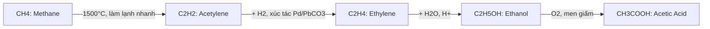

# 🎓 Kho Tri Thức & Công Thức THPT Toàn Diện (GDPT 2018)

[](https://github.com/CAZRALO/Kien-thuc-THPT.git)
[](https://moet.gov.vn/)
[](https://daringfireball.net/projects/markdown/)
[](https://katex.org/)
[](https://mermaid.js.org/)
[](LICENSE)

> **Kho lưu trữ mã nguồn mở hệ thống hoá toàn bộ kiến thức, lý thuyết, công thức trọng tâm và hình vẽ biểu diễn trực quan cho học sinh THPT (Lớp 10, Lớp 11, Lớp 12) theo Chương trình Giáo dục Phổ thông mới (GDPT 2018).**

---

## 🌟 Tính Năng Nổi Bật

1. 📂 **Cấu trúc phân tầng khoa học:** Phân chia rõ ràng: `Môn học` ➡️ `Lớp (10, 11, 12)` ➡️ `Chương` ➡️ `Chủ đề / Bài học`.
2. 📐 **Hệ thống công thức chuẩn $LaTeX$:** Toàn bộ công thức Toán học, Vật lí, Hóa học được gõ bằng cú pháp chuẩn MathJax / KaTeX, hiển thị sắc nét trên cả máy tính, máy tính bảng và điện thoại.
3. 📊 **Hình biểu diễn đa phương tiện bằng Markdown:**
   - **Mermaid Diagrams:** Sơ đồ tư duy (Mindmap), lưu đồ thuật toán (Flowchart), quy trình chuyển hoá và chu trình.
   - **Vector SVG:** Đồ thị hàm số, hệ trục toạ độ $Oxy$ / $Oxyz$, bảng biến thiên, hình học không gian, mạch điện, mô hình phân tử nhúng trực tiếp chuẩn vector, không vỡ hạt khi zoom.
4. 💡 **Phương pháp giải & Bài tập mẫu:** Mỗi bài học đều có phân dạng bài tập từ nhận biết, thông hiểu đến vận dụng và mẹo giải nhanh trắc nghiệm.
5. 🔍 **Dễ dàng tìm kiếm & tra cứu:** Tối ưu hoá cho việc đọc trên GitHub web, VS Code, Obsidian hoặc xuất sang PDF/HTML.

---

## 🧭 Bản Đồ Điều Hướng Môn Học

| STT | Môn Học | Icon | Cấp Độ | Số Chương | Mô Tả Trọng Tâm |
|:---:|:---|:---:|:---:|:---:|:---|
| 1 | [**Toán Học**](./Toan/README.md) | 📐 | Lớp [10](./Toan/Lop_10/README.md) • [11](./Toan/Lop_11/README.md) • [12](./Toan/Lop_12/README.md) | 24 | Đại số, Giải tích, Đạo hàm, Tích phân, Hình học phẳng Oxy, Toạ độ không gian Oxyz, Xác suất |
| 2 | [**Vật Lí**](./Vat_Ly/README.md) | ⚡ | Lớp [10](./Vat_Ly/Lop_10/README.md) • [11](./Vat_Ly/Lop_11/README.md) • [12](./Vat_Ly/Lop_12/README.md) | 15 | Cơ học Newton, Dao động, Sóng, Điện trường, Vật lí nhiệt, Khí lí tưởng, Từ trường, Hạt nhân |
| 3 | [**Hóa Học**](./Hoa_Hoc/README.md) | 🧪 | Lớp [10](./Hoa_Hoc/Lop_10/README.md) • [11](./Hoa_Hoc/Lop_11/README.md) • [12](./Hoa_Hoc/Lop_12/README.md) | 20 | Cấu tạo nguyên tử, Bảng tuần hoàn, Enthalpy nhiệt hoá, Cân bằng hoá học, Hữu cơ, Polymer, Pin điện |
| 4 | [**Sinh Học**](./Sinh_Hoc/README.md) | 🧬 | Lớp [10](./Sinh_Hoc/Lop_10/README.md) • [11](./Sinh_Hoc/Lop_11/README.md) • [12](./Sinh_Hoc/Lop_12/README.md) | 11 | Sinh học tế bào, Trao đổi chất & năng lượng, Di truyền phân tử ADN/ARN, Quy luật Mendel, Tiến hoá, Sinh thái |
| 5 | [**Tin Học**](./Tin_Hoc/README.md) | 💻 | Lớp [10](./Tin_Hoc/Lop_10/README.md) • [11](./Tin_Hoc/Lop_11/README.md) • [12](./Tin_Hoc/Lop_12/README.md) | 7 | Lập trình Python, Thuật toán tìm kiếm & sắp xếp, CSDL & SQL, Mạng máy tính & An toàn thông tin, AI |
| 6 | [**Ngữ Văn**](./Ngu_Van/README.md) | 📚 | Lớp [10](./Ngu_Van/Lop_10/README.md) • [11](./Ngu_Van/Lop_11/README.md) • [12](./Ngu_Van/Lop_12/README.md) | 6 | Sử thi, Thơ Đường luật, Thơ Mới, Văn học hiện thực & lãng mạn, Kĩ năng viết bài nghị luận xã hội & văn học |
| 7 | [**Tiếng Anh**](./Tieng_Anh/README.md) | 🌐 | Lớp [10](./Tieng_Anh/Lop_10/README.md) • [11](./Tieng_Anh/Lop_11/README.md) • [12](./Tieng_Anh/Lop_12/README.md) | 3 | 12 thì cơ bản & nâng cao, Câu bị động đặc biệt, Mệnh đề quan hệ rút gọn, Cấu trúc đảo ngữ, Collocations |
| 8 | [**Lịch Sử**](./Lich_Su/README.md) | 🏛️ | Lớp [10](./Lich_Su/Lop_10/README.md) • [11](./Lich_Su/Lop_11/README.md) • [12](./Lich_Su/Lop_12/README.md) | 5 | Văn minh nhân loại, Cách mạng tư sản, Trật tự thế giới sau 1945, Phong trào dân tộc và các cuộc kháng chiến VN |
| 9 | [**Địa Lí**](./Dia_Ly/README.md) | 🌍 | Lớp [10](./Dia_Ly/Lop_10/README.md) • [11](./Dia_Ly/Lop_11/README.md) • [12](./Dia_Ly/Lop_12/README.md) | 6 | Thạch quyển, Khí quyển, Địa lí kinh tế các cường quốc Hoa Kỳ/EU/ASEAN, Địa lí tự nhiên & 7 vùng kinh tế VN |
| 10 | [**GDKT & PL**](./GDKT_va_PL/README.md) | ⚖️ | Lớp [10](./GDKT_va_PL/Lop_10/README.md) • [11](./GDKT_va_PL/Lop_11/README.md) • [12](./GDKT_va_PL/Lop_12/README.md) | 4 | Quy luật kinh tế thị trường, Lạm phát, Thất nghiệp, Tăng trưởng GDP/GNI, Hệ thống pháp luật & Quyền công dân |

---

## 🌳 Cấu Trúc Thư Mục Chuẩn

```text
Kien-thuc-THPT/
│
├── README.md                                    # Tài liệu tổng quan & hướng dẫn
├── Toan/                                        # Môn Toán học
│   ├── README.md
│   ├── Lop_10/
│   │   ├── README.md
│   │   ├── Chuong_01_Menh_de_va_tap_hop/
│   │   │   ├── README.md
│   │   │   ├── 01_Menh_de_toan_hoc.md
│   │   │   └── 02_Tap_hop_va_cac_phep_toan.md
│   │   ├── Chuong_04_Vecto/
│   │   └── ...
│   ├── Lop_11/
│   └── Lop_12/
│       ├── Chuong_01_Ung_dung_dao_ham_khao_sat_va_ve_do_thi_ham_so/
│       │   ├── 01_Tinh_don_dieu_cua_ham_so.md
│       │   ├── 02_Cuc_tri_cua_ham_so.md
│       │   ├── 03_Gia_tri_lon_nhat_va_nho_nhat.md
│       │   ├── 04_Duong_tiem_can_cua_do_thi.md
│       │   └── 05_Khao_sat_su_bien_thien_va_ve_do_thi.md
│       ├── Chuong_02_Toa_do_vecto_trong_khong_gian_Oxyz/
│       ├── Chuong_04_Nguyen_ham_va_tich_phan/
│       └── ...
├── Vat_Ly/                                      # Môn Vật lí
│   ├── Lop_10/ (Chuyển động, Định luật Newton, Động lượng, Năng lượng...)
│   ├── Lop_11/ (Dao động cơ, Sóng cơ, Điện trường, Dòng điện...)
│   └── Lop_12/ (Vật lí nhiệt, Khí lí tưởng, Từ trường, Hạt nhân...)
├── Hoa_Hoc/                                     # Môn Hóa học
│   ├── Lop_10/ (Nguyên tử, Bảng tuần hoàn, Liên kết hoá học, Oxi hoá khử, Enthalpy...)
│   ├── Lop_11/ (Cân bằng hoá học, Nitrogen - Sulfur, Hữu cơ, Hydrocarbon...)
│   └── Lop_12/ (Ester - Lipid, Carbohydrate, Amine - Protein, Polymer, Pin điện...)
├── Sinh_Hoc/                                    # Môn Sinh học
├── Tin_Hoc/                                     # Môn Tin học
├── Ngu_Van/                                     # Môn Ngữ văn
├── Tieng_Anh/                                   # Môn Tiếng Anh
├── Lich_Su/                                     # Môn Lịch sử
├── Dia_Ly/                                      # Môn Địa lí
└── GDKT_va_PL/                                  # Môn Giáo dục Kinh tế & Pháp luật
```

---

## 🎨 Hướng Dẫn Trình Bày Công Thức & Hình Vẽ Bằng Markdown

### 1. Cú pháp Công Thức Toán/Lý/Hóa ($LaTeX$)

- **Công thức cùng dòng (Inline Math):** Kẹp giữa 2 dấu `$ ... $`.  
  *Ví dụ:* Định luật vạn vật hấp dẫn $F_{hd} = G \frac{m_1 m_2}{r^2}$.
- **Công thức khối độc lập (Block Math):** Kẹp giữa cặp `$$ ... $$`.  
  *Ví dụ:*
  ```latex
  $$f'(x_0) = \lim_{\Delta x \to 0} \frac{f(x_0 + \Delta x) - f(x_0)}{\Delta x}$$
  ```
  Sẽ hiển thị:
  $$f'(x_0) = \lim_{\Delta x \to 0} \frac{f(x_0 + \Delta x) - f(x_0)}{\Delta x}$$

### 2. Sơ đồ tư duy & Quy trình bằng Mermaid

Dùng khối mã ```` ```mermaid ```` để tạo sơ đồ tư duy, lưu đồ thuật toán hoặc quy trình chuyển hoá:



### 3. Hình vẽ biểu diễn kỹ thuật & Đồ thị bằng SVG

Vector SVG được nhúng trực tiếp trong file `.md` giúp hiển thị chuẩn xác hệ trục toạ độ, hình học không gian, mạch điện hay đồ thị dao động mà không cần tải ảnh ngoài:

<div align="center">
<svg width="340" height="180" viewBox="0 0 340 180" xmlns="http://www.w3.org/2000/svg">
  <defs>
    <marker id="arrow" viewBox="0 0 10 10" refX="5" refY="5" markerWidth="6" markerHeight="6" orient="auto-start-reverse">
      <path d="M 0 0 L 10 5 L 0 10 z" fill="#3b82f6"/>
    </marker>
  </defs>
  <!-- Background -->
  <rect width="340" height="180" rx="10" fill="#0f172a"/>
  <!-- Grid -->
  <line x1="20" y1="90" x2="320" y2="90" stroke="#334155" stroke-dasharray="4"/>
  <line x1="170" y1="20" x2="170" y2="160" stroke="#334155" stroke-dasharray="4"/>
  <!-- Axes -->
  <line x1="30" y1="90" x2="310" y2="90" stroke="#3b82f6" stroke-width="2" marker-end="url(#arrow)"/>
  <text x="315" y="94" fill="#94a3b8" font-size="12" font-family="sans-serif">x</text>
  <line x1="170" y1="160" x2="170" y2="25" stroke="#3b82f6" stroke-width="2" marker-end="url(#arrow)"/>
  <text x="175" y="25" fill="#94a3b8" font-size="12" font-family="sans-serif">y</text>
  <text x="156" y="105" fill="#94a3b8" font-size="12" font-family="sans-serif">O</text>
  <!-- Sine Curve -->
  <path d="M 50 90 Q 80 20 110 90 T 170 90 T 230 90 T 290 90" fill="none" stroke="#10b981" stroke-width="3"/>
  <text x="210" y="45" fill="#10b981" font-weight="bold" font-size="13" font-family="sans-serif">y = sin(x)</text>
</svg>
<br>
<em>Minh hoạ đồ thị hàm số chuẩn Vector SVG hiển thị trên mọi nền</em>
</div>

---

## 🤝 Hướng Dẫn Đóng Góp (Contribution Guidelines)

Chúng tôi rất hoan nghênh sự đóng góp từ quý thầy cô giáo, các bạn học sinh và cộng đồng yêu giáo dục!

1. **Fork** repository này về tài khoản của bạn.
2. Tạo nhánh mới cho bài học cần thêm:
   ```bash
   git checkout -b feature/toan-12-tich-phan
   ```
3. Tuân thủ cấu trúc một bài học Markdown:
   - `🎯 Mục tiêu bài học`
   - `📖 I. Lý thuyết trọng tâm`
   - `🔢 II. Hệ thống công thức cần nhớ`
   - `📊 III. Sơ đồ tư duy & Hình biểu diễn`
   - `💡 IV. Các dạng bài tập & Phương pháp giải`
   - `📝 V. Ví dụ minh họa có lời giải chi tiết`
   - `⚡ VI. Tóm tắt ghi nhớ nhanh (Cheat Sheet)`
4. **Commit** thay đổi và tạo **Pull Request** lên nhánh `main`.

---

## 📄 Bản Quyền (License)

Dự án được phân phối dưới giấy phép [MIT License](LICENSE). Mọi người đều có quyền tự do học tập, chia sẻ và đóng góp vì mục tiêu phổ cập kiến thức chất lượng cao cho học sinh Việt Nam.
