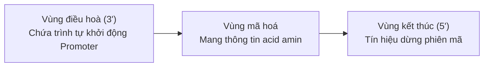

# 📌 Chủ Đề: Gen, Mã Di Truyền và Quá Trình Tái Bản ADN

> **Chương trình:** Sinh Học 12 (GDPT 2018)  
> **Chương I:** Di truyền phân tử  
> **Mức độ:** Cơ bản đến Chuyên sâu

---

## 🎯 Mục Tiêu Bài Học
- Nêu được khái niệm gen, cấu trúc chung của một gen cấu trúc (Vùng điều hoà, Vùng mã hoá, Vùng kết thúc).
- Hiểu được các đặc điểm của mã di truyền: Mã bộ ba, tính phổ biến, tính đặc hiệu, tính thoái hoá.
- Trình bày diễn biến quá trình nhân đôi (tái bản) ADN theo nguyên tắc bổ sung và bán bảo tồn.
- Tính toán thành thạo các thông số phân tử: Số nucleotide, chiều dài, số liên kết hydrogen, số đoạn mồi RNA.

---

## 📖 I. Lý Thuyết Cốt Lõi

### 1. Cấu trúc của Gen
Gen là một đoạn phân tử ADN mang thông tin mã hoá cho một chuỗi polypeptide hay một phân tử ARN.

Cấu trúc một gen điển hình gồm 3 vùng theo chiều $3' \to 5'$ trên mạch khuôn:

### 2. Đặc điểm của Mã Di Truyền
Mã di truyền là mã bộ ba (triplet): Cứ 3 nucleotide liền kề trên mARN mã hoá cho 1 amino acid.
- **Có $4^3 = 64$ codon**, trong đó:
  - **1 codon mở đầu:** $5'\text{AUG}3'$ (mã hoá Methionine ở sinh vật nhân thực, Formyl-methionine ở nhân sơ).
  - **3 codon kết thúc:** $5'\text{UAA}3'$, $5'\text{UAG}3'$, $5'\text{UGA}3'$ (không mã hoá amino acid).
  - **61 codon** mã hoá cho 20 loại amino acid.
- **Đặc điểm cốt lõi:**
  1. *Tính liên tục:* Đọc từ một điểm xác định từng bộ ba một, không gối lên nhau.
  2. *Tính phổ biến:* Hầu hết mọi loài sinh vật đều dùng chung một bộ mã di truyền.
  3. *Tính đặc hiệu:* Mỗi codon chỉ mã hoá cho **duy nhất 1 loại** amino acid.
  4. *Tính thoái hoá (dư thừa):* Nhiều codon khác nhau cùng mã hoá cho **1 loại** amino acid (trừ AUG và UGG).

---

## 🔢 II. Quá Trình Tái Bản (Nhân Đôi) ADN

Quá trình nhân đôi ADN diễn ra ở pha S của kì trung gian trong chu kì tế bào, gồm 3 bước:
1. **Tháo xoắn phân tử ADN:** Nhờ enzyme DNA helicase và topoisomerase làm đứt các liên kết hydrogen, tạo chạc chữ Y.
2. **Tổng hợp mạch ADN mới:** 
   - Enzyme **RNA polymerase (primase)** tổng hợp đoạn mồi RNA ngắn có đầu $3'-\text{OH}$ tự do.
   - Enzyme **DNA polymerase** di chuyển dọc trên mạch khuôn theo chiều $3' \to 5'$ để kéo dài mạch mới theo chiều $5' \to 3'$ tuân theo **nguyên tắc bổ sung** ($A - T$, $G - C$).
   - Mạch khuôn $3' \to 5'$: Mạch mới được tổng hợp **liên tục**.
   - Mạch khuôn $5' \to 3'$: Mạch mới tổng hợp **gián đoạn** thành từng đoạn ngắn **Okazaki**.
3. **Nối các đoạn Okazaki:** Enzyme cắt bỏ đoạn mồi, điền nucleotide ADN và enzyme **DNA ligase** nối liền mạch.

---

## 📊 III. Sơ Đồ Chạc Tái Bản ADN Chữ Y (SVG)

<svg width="600" height="300" viewBox="0 0 600 300" xmlns="http://www.w3.org/2000/svg">
  <rect width="600" height="300" rx="12" fill="#0f172a" stroke="#334155" stroke-width="2"/>

  <!-- Fork Title -->
  <text x="300" y="30" fill="#38bdf8" font-size="15" font-weight="bold" text-anchor="middle">Mô Hình Chạc Chữ Y Tái Bản ADN</text>

  <!-- Unwinding Fork -->
  <!-- Template Upper (3' to 5') -->
  <path d="M 50 80 L 300 80 L 550 50" fill="none" stroke="#60a5fa" stroke-width="4"/>
  <text x="40" y="85" fill="#60a5fa" font-weight="bold" font-size="13">3'</text>
  <text x="560" y="55" fill="#60a5fa" font-weight="bold" font-size="13">5'</text>

  <!-- Template Lower (5' to 3') -->
  <path d="M 50 220 L 300 220 L 550 250" fill="none" stroke="#60a5fa" stroke-width="4"/>
  <text x="40" y="225" fill="#60a5fa" font-weight="bold" font-size="13">5'</text>
  <text x="560" y="255" fill="#60a5fa" font-weight="bold" font-size="13">3'</text>

  <!-- Continuous new strand -->
  <path d="M 120 110 L 450 110" fill="none" stroke="#22c55e" stroke-width="3" stroke-dasharray="4"/>
  <polygon points="450,110 440,105 440,115" fill="#22c55e"/>
  <text x="250" y="105" fill="#22c55e" font-size="11" font-weight="bold">Mạch dẫn đầu (Tổng hợp liên tục 5' -&gt; 3')</text>

  <!-- Discontinuous Okazaki fragments -->
  <!-- Fragment 1 -->
  <line x1="200" y1="190" x2="130" y2="190" stroke="#f59e0b" stroke-width="3"/>
  <polygon points="130,190 140,185 140,195" fill="#f59e0b"/>
  <!-- Fragment 2 -->
  <line x1="330" y1="190" x2="240" y2="190" stroke="#f59e0b" stroke-width="3"/>
  <polygon points="240,190 250,185 250,195" fill="#f59e0b"/>
  <!-- Fragment 3 -->
  <line x1="460" y1="190" x2="370" y2="190" stroke="#f59e0b" stroke-width="3"/>
  <polygon points="370,190 380,185 380,195" fill="#f59e0b"/>
  <text x="280" y="180" fill="#f59e0b" font-size="11" font-weight="bold">Các đoạn Okazaki (Tổng hợp gián đoạn)</text>

  <!-- Helicase enzyme icon -->
  <polygon points="530,150 490,120 490,180" fill="#ec4899" opacity="0.8"/>
  <text x="500" y="155" fill="#ffffff" font-size="10" text-anchor="middle">Helicase</text>
  <text x="500" y="195" fill="#ec4899" font-size="10" text-anchor="middle">Chiều tháo xoắn</text>
</svg>
 
<em>Hình 1.5: Chiều tổng hợp liên tục và gián đoạn tại chạc ba tái bản</em>

---

## 🔢 IV. Bảng Công Thức Tính Toán Phân Tử ADN

1. **Tổng số nucleotide của gen:**
   $$N = 2A + 2G = 2T + 2C$$
   $$A = T, \quad G = C \implies A + G = 50\% N$$
2. **Chiều dài gen ($L$ tính bằng Angstrom $\text{Å}$, $1\text{ nm} = 10\text{ Å}$):**
   $$L = \frac{N}{2} \times 3,4\text{ Å}$$
3. **Số liên kết hydrogen ($H$):**
   $$H = 2A + 3G = 2T + 3C = N + G$$
4. **Sau $k$ lần tái bản từ 1 phân tử ADN ban đầu:**
   - Số phân tử ADN con tạo thành: $2^k$
   - Số phân tử ADN con giữ nguyên 1 mạch gốc cũ (bán bảo tồn): $2$
   - Số phân tử ADN cấu tạo hoàn toàn từ nguyên liệu môi trường: $2^k - 2$
   - Số nucleotide môi trường cung cấp:
     $$N_{\text{mt}} = N \times (2^k - 1)$$
     $$A_{\text{mt}} = T_{\text{mt}} = A \times (2^k - 1)$$
     $$G_{\text{mt}} = C_{\text{mt}} = G \times (2^k - 1)$$
