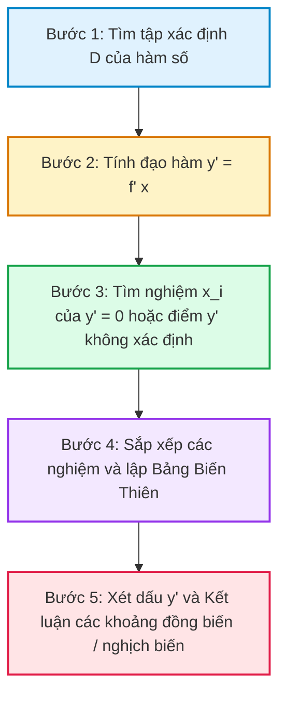

# 📌 Chủ Đề: Tính Đơn Điệu Của Hàm Số

> **Chương trình:** Toán 12 (GDPT 2018)  
> **Chương I:** Ứng dụng đạo hàm để khảo sát và vẽ đồ thị hàm số  
> **Mức độ:** Nhận biết - Thông hiểu - Vận dụng

---

## 🎯 Mục Tiêu Bài Học
- Hiểu định nghĩa hàm số đồng biến (tăng) và nghịch biến (giảm) trên một khoảng, đoạn hoặc nửa khoảng.
- Nắm vững mối liên hệ giữa dấu của đạo hàm cấp một $f'(x)$ và tính đơn điệu của hàm số $f(x)$.
- Thành thạo các bước lập bảng biến thiên và kết luận khoảng đơn điệu.
- Vận dụng giải các bài toán chứa tham số $m$ để hàm số đơn điệu trên từng khoảng xác định hoặc trên $\mathbb{R}$.

---

## 📖 I. Lý Thuyết Trọng Tâm

### 1. Định nghĩa tính đơn điệu
Kí hiệu $K$ là một khoảng, một đoạn hoặc một nửa khoảng. Giả sử hàm số $y = f(x)$ xác định trên $K$.
- Hàm số $y = f(x)$ gọi là **đồng biến (tăng)** trên $K$ nếu:
  $$\forall x_1, x_2 \in K: x_1 < x_2 \implies f(x_1) < f(x_2)$$
- Hàm số $y = f(x)$ gọi là **nghịch biến (giảm)** trên $K$ nếu:
  $$\forall x_1, x_2 \in K: x_1 < x_2 \implies f(x_1) > f(x_2)$$

### 2. Định lý về dấu của đạo hàm
Giả sử hàm số $y = f(x)$ có đạo hàm trên khoảng $K$:
1. Nếu $f'(x) > 0, \forall x \in K$ thì hàm số $f(x)$ **đồng biến** trên $K$.
2. Nếu $f'(x) < 0, \forall x \in K$ thì hàm số $f(x)$ **nghịch biến** trên $K$.
3. Nếu $f'(x) = 0, \forall x \in K$ thì hàm số $f(x)$ là **hàm hằng** trên $K$.

> **Định lý mở rộng:**  
> Nếu $f'(x) \ge 0$ (hoặc $f'(x) \le 0$), $\forall x \in K$ và dấu đẳng thức $f'(x) = 0$ chỉ xảy ra tại một số hữu hạn điểm trên $K$ thì hàm số $f(x)$ **đồng biến** (hoặc **nghịch biến**) trên $K$.

---

## 🔢 II. Hệ Thống Công Thức Cần Nhớ

| Hàm Số | Đạo Hàm $y'$ | Điều Kiện Đồng Biến Trên $\mathbb{R}$ | Điều Kiện Nghịch Biến Trên $\mathbb{R}$ |
|:---|:---|:---|:---|
| **Bậc ba:** $y = ax^3 + bx^2 + cx + d$ $(a \ne 0)$ | $y' = 3ax^2 + 2bx + c$ | $\begin{cases} a > 0 \\ \Delta' \le 0 \end{cases}$ | $\begin{cases} a < 0 \\ \Delta' \le 0 \end{cases}$ |
| **Phân thức bậc nhất:** $y = \frac{ax + b}{cx + d}$ $(ad - bc \ne 0)$ | $y' = \frac{ad - bc}{(cx + d)^2}$ | $ad - bc > 0$ trên từng khoảng $XĐ$ | $ad - bc < 0$ trên từng khoảng $XĐ$ |
| **Phân thức bậc hai / bậc nhất:** $y = \frac{ax^2 + bx + c}{mx + n}$ | $y' = \frac{amx^2 + 2anx + (bn - cm)}{(mx + n)^2}$ | $y' \ge 0$ trên tập xác định | $y' \le 0$ trên tập xác định |

---

## 📊 III. Sơ Đồ Tư Duy & Hình Biểu Diễn Trực Quan

### 1. Sơ đồ tư duy các bước xét tính đơn điệu (Mermaid)

### 2. Hình biểu diễn: Minh họa đồ thị và tiếp tuyến có hệ số góc $k = f'(x)$ (SVG)

<svg width="600" height="280" viewBox="0 0 600 280" xmlns="http://www.w3.org/2000/svg">
  <defs>
    <marker id="arrow" viewBox="0 0 10 10" refX="5" refY="5" markerWidth="6" markerHeight="6" orient="auto-start-reverse">
      <path d="M 0 0 L 10 5 L 0 10 z" fill="#64748b"/>
    </marker>
  </defs>

  <!-- Background Card -->
  <rect width="600" height="280" rx="12" fill="#0f172a" stroke="#1e293b" stroke-width="2"/>

  <!-- Left: Đồng biến -->
  <g transform="translate(30, 20)">
    <text x="110" y="25" fill="#38bdf8" font-size="14" font-weight="bold" text-anchor="middle">Đồng Biến: f'(x) &gt; 0</text>
    <!-- Axes -->
    <line x1="20" y1="200" x2="220" y2="200" stroke="#64748b" stroke-width="1.5" marker-end="url(#arrow)"/>
    <line x1="40" y1="210" x2="40" y2="40" stroke="#64748b" stroke-width="1.5" marker-end="url(#arrow)"/>
    <text x="220" y="215" fill="#94a3b8" font-size="12">x</text>
    <text x="30" y="45" fill="#94a3b8" font-size="12">y</text>
    <!-- Curve -->
    <path d="M 45 180 C 100 170, 140 100, 200 60" fill="none" stroke="#22c55e" stroke-width="3"/>
    <!-- Tangent line -->
    <line x1="80" y1="180" x2="180" y2="70" stroke="#f59e0b" stroke-dasharray="4" stroke-width="2"/>
    <circle cx="130" cy="125" r="4" fill="#f59e0b"/>
    <text x="140" y="125" fill="#f59e0b" font-size="11">Tiếp tuyến dốc lên (k &gt; 0)</text>
    <text x="110" y="235" fill="#cbd5e1" font-size="12" text-anchor="middle">Đồ thị đi lên từ trái sang phải</text>
  </g>

  <!-- Vertical separator -->
  <line x1="295" y1="30" x2="295" y2="250" stroke="#334155" stroke-dasharray="4"/>

  <!-- Right: Nghịch biến -->
  <g transform="translate(320, 20)">
    <text x="110" y="25" fill="#f43f5e" font-size="14" font-weight="bold" text-anchor="middle">Nghịch Biến: f'(x) &lt; 0</text>
    <!-- Axes -->
    <line x1="20" y1="200" x2="220" y2="200" stroke="#64748b" stroke-width="1.5" marker-end="url(#arrow)"/>
    <line x1="40" y1="210" x2="40" y2="40" stroke="#64748b" stroke-width="1.5" marker-end="url(#arrow)"/>
    <text x="220" y="215" fill="#94a3b8" font-size="12">x</text>
    <text x="30" y="45" fill="#94a3b8" font-size="12">y</text>
    <!-- Curve -->
    <path d="M 45 60 C 100 100, 140 170, 200 180" fill="none" stroke="#ef4444" stroke-width="3"/>
    <!-- Tangent line -->
    <line x1="80" y1="70" x2="180" y2="180" stroke="#f59e0b" stroke-dasharray="4" stroke-width="2"/>
    <circle cx="130" cy="125" r="4" fill="#f59e0b"/>
    <text x="140" y="115" fill="#f59e0b" font-size="11">Tiếp tuyến dốc xuống (k &lt; 0)</text>
    <text x="110" y="235" fill="#cbd5e1" font-size="12" text-anchor="middle">Đồ thị đi xuống từ trái sang phải</text>
  </g>
</svg>
 
<em>Hình 1.1: Ý nghĩa hình học của đạo hàm đối với tính đơn điệu</em>

---

## 💡 IV. Các Dạng Bài Tập & Phương Pháp Giải

### Dạng 1: Xét tính đơn điệu của hàm số cho trước
- **Phương pháp giải:**
  1. Tìm tập xác định $D$.
  2. Tính đạo hàm $y' = f'(x)$.
  3. Giải phương trình $y' = 0$ tìm các nghiệm $x_i \in D$ hoặc các điểm làm cho $y'$ không xác định.
  4. Lập bảng xét dấu $y'$ (Bảng biến thiên).
  5. Đọc kết luận các khoảng đồng biến (nơi $y' > 0$) và nghịch biến (nơi $y' < 0$).

### Dạng 2: Tìm tham số $m$ để hàm số đơn điệu trên khoảng $(a; b)$
- **Phương pháp 1 (Cô lập tham số $m$):**  
  Biến đổi điều kiện $y' \ge 0 \iff m \ge g(x)$ (hoặc $m \le g(x)$), $\forall x \in (a; b)$.  
  - $m \ge g(x), \forall x \in (a; b) \iff m \ge \max_{[a; b]} g(x)$ (nếu tồn tại $\max$).  
  - $m \le g(x), \forall x \in (a; b) \iff m \le \min_{[a; b]} g(x)$ (nếu tồn tại $\min$).
- **Phương pháp 2 (Dùng định lý tam thức bậc hai):**  
  Khi không cô lập được $m$, áp dụng dấu của tam thức bậc hai $g(x) = Ax^2 + Bx + C$ với $\Delta$ và so sánh nghiệm với các đầu mút.

---

## 📝 V. Ví Dụ Minh Họa Có Lời Giải Chi Tiết

### Ví dụ 1 (Mức độ Nhận biết - Thông hiểu):
**Đề bài:** Xét sự biến thiên của hàm số $y = x^3 - 3x^2 + 2$.

**Lời giải chi tiết:**
1. **Tập xác định:** $D = \mathbb{R}$.
2. **Đạo hàm:**
   $$y' = 3x^2 - 6x = 3x(x - 2)$$
   $$y' = 0 \iff \left[\begin{array}{l} x = 0 \\ x = 2 \end{array}\right.$$
3. **Bảng biến thiên:**

| $x$ | $-\infty$ | | $0$ | | $2$ | | $+\infty$ |
|:---:|:---:|:---:|:---:|:---:|:---:|:---:|:---:|
| $y'$ | | $+$ | $0$ | $-$ | $0$ | $+$ | |
| $y$ | $-\infty$ | $\nearrow$ | $2$ | $\searrow$ | $-2$ | $\nearrow$ | $+\infty$ |

4. **Kết luận:**
   - Hàm số đồng biến trên các khoảng $(-\infty; 0)$ và $(2; +\infty)$.
   - Hàm số nghịch biến trên khoảng $(0; 2)$.

---

### Ví dụ 2 (Mức độ Vận dụng):
**Đề bài:** Tìm tất cả các giá trị của tham số $m$ để hàm số $y = \frac{1}{3}x^3 - mx^2 + (m^2 - 4)x + 3$ đồng biến trên $\mathbb{R}$.

**Lời giải chi tiết:**
1. Tập xác định: $D = \mathbb{R}$.
2. Đạo hàm:
   $$y' = x^2 - 2mx + (m^2 - 4)$$
   Hàm số đã cho đồng biến trên $\mathbb{R}$ khi và chỉ khi:
   $$y' \ge 0, \forall x \in \mathbb{R} \iff x^2 - 2mx + (m^2 - 4) \ge 0, \forall x \in \mathbb{R}$$
3. Vì tam thức bậc hai có hệ số $a = 1 > 0$, nên điều kiện tương đương:
   $$\Delta' \le 0 \iff (-m)^2 - 1.(m^2 - 4) \le 0$$
   $$\iff m^2 - m^2 + 4 \le 0 \iff 4 \le 0 \text{ (Vô lí!)}$$
4. **Kết luận:** Không tồn tại giá trị nào của tham số $m$ thỏa mãn yêu cầu bài toán.

---

## ⚡ VI. Tóm Tắt Ghi Nhớ Nhanh (Cheat Sheet)

> [!TIP]
> - Nếu hàm số đồng biến trên $(a; b)$ và liên tục tại các đầu mút $a, b$ thì ta được phép kết luận hàm số đồng biến trên đoạn $[a; b]$.
> - Đối với hàm phân thức hữu tỉ bậc nhất $y = \frac{ax + b}{cx + d}$, dấu của đạo hàm **không có dấu bằng**:  
>   $$y' = \frac{ad - bc}{(cx + d)^2} > 0 \implies ad - bc > 0$$ (không được lấy dấu bằng vì khi $ad - bc = 0$ hàm trở thành hàm hằng).
